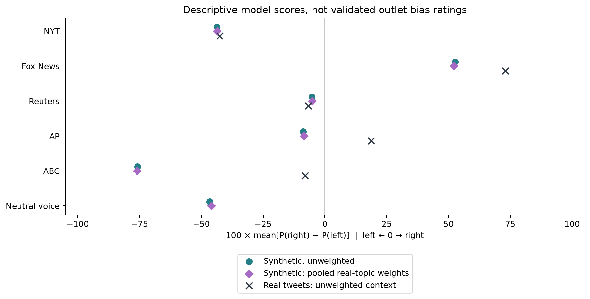

# Real vs. Expected News Tweets: Political-Leaning Analysis

This project asks: **How does the political leaning of real news tweets differ
from what an AI model expects those outlets to write?** We run the same
political-leaning and topic classifiers over actual posts and Claude Haiku’s
generated outlet-style tweets, then compare their outputs.

Here, **“expected” means Haiku-generated text in an outlet’s requested voice**.
It is a model-generated baseline, not a forecast, a human judgment, or a standard
for how the outlet should report. The project’s “sentiment” measure is U.S.
political leaning—left, center, or right—rather than positive/negative emotion.

> **v2 (current work): read [docs/STATUS.md](docs/STATUS.md) first.** v2 re-examines v1 with a pre-registered
> protocol ([docs/protocol_v2.md](docs/protocol_v2.md)), validity checks, a blind LLM judge and new generation
> conditions. The working paper is [docs/paper/paper.md](docs/paper/paper.md). Several v1 results below turn out to
> be classifier artifacts: a trailing link changes the classifier's label for 37% of tweets, and swapping party names
> moves its score on neutral text by about 80 points. See paper section 6.4 for how each v1 gap changes.
> Environment: `requirements-study.txt`; code: `study/`.

## V1: real versus expected leaning

The primary comparison uses **2,500 real tweets** (500 per outlet) and
**2,625 synthetic tweets** (525 per matching outlet, thinking off). Another 525
synthetic tweets use a generic news-organization voice; these are a separate
baseline and are excluded from the five-outlet comparison below. The 840-response
thinking-on/off pilot is reported separately in [V1Results.md](V1Results.md).

For each group, the signed score is `100 × mean[P(right) − P(left)]`:
negative values lean left in the classifier’s output; positive values lean right.
The difference is **real minus expected**, calculated before rounding. A positive
difference means the real sample scores farther right than the synthetic sample;
it does not necessarily mean the real sample is right-leaning overall. This score
is neither confidence nor a validated measure of bias intensity.

| Outlet | Real score | Expected score | Real − expected | Real center labels | Expected center labels |
|---|---:|---:|---:|---:|---:|
| New York Times | -42.5 | -43.7 | +1.2 | 1.0% | 45.5% |
| Fox News | +73.1 | +52.7 | +20.4 | 0.0% | 2.7% |
| Reuters | -6.8 | -5.3 | -1.5 | 5.8% | 63.0% |
| Associated Press | +18.8 | -8.8 | +27.6 | 0.0% | 62.9% |
| ABC News | -8.0 | -75.8 | +67.8 | 1.0% | 21.0% |

- **ABC has the largest gap:** its real tweets score −8.0, while its generated
  voice scores −75.8. Haiku’s ABC-style output is much more left-leaning according
  to this classifier.
- **AP crosses zero:** its real sample scores +18.8 and its generated voice −8.8.
  Fox’s real sample also scores farther right than its generated voice (+73.1
  versus +52.7).
- **NYT and Reuters have similar average scores across datasets, but different
  label distributions.** For example, NYT receives 1.0% center labels in real posts
  versus 45.5% in generated posts. Similar averages can conceal large differences
  in the mix of predictions.
- **Across the same five outlets, center labels rise from 1.6% in real tweets to
  39.0% in generated tweets.** This is a change in classifier behavior across
  datasets, not proof that generated writing is more neutral.



The table uses unweighted results for both datasets. The graph also shows
synthetic scores weighted back to the pooled real-topic mix to account for
oversampling of smaller topics. Those adjustments are small in V1 and preserve
the ordering of the synthetic voice scores. The graph’s neutral voice has no
corresponding real outlet.

## What the comparison can tell us

The results reveal differences between **real outlet posts and Haiku’s portrayal
of those outlets, as measured by the current classifier**. They combine choices
made by the outlet, the generator, and the classifier; they cannot isolate which
one causes a difference.

The synthetic prompts specify an outlet and topic, but provide no shared event
or factual source. Real and generated tweets therefore differ in stories, topic
mix, candidate mentions, language, and writing style. They are not matched
versions of the same reporting. The real sample is drawn from an election-related
dataset, rather than each outlet’s full posting history.

There are no human-verified leaning labels. The classifier has also assigned
very high confidence to questionable partisan labels on routine factual news.
Treat these results as an exploratory comparison, not verified outlet bias
ratings. Topic controls need care too: V1 topic prompt agreement is **53.7%**,
and only **1 of 1,170** synthetic responses requested under “president” received
that label. Topic-based weighting inherits the topic model’s limitations.

## Results and data

- **[V1Results.md](V1Results.md):** full methods, six graphs, topic metrics,
  leaning distributions, pilot comparisons, and data-quality checks.
- **[Machine-readable metrics](reports/v1/metrics.json):** source for the comparison
  table and all aggregate results.
- **[Real-tweet CSV](dataset/tweet_manifest.csv):** outlet, original tweet, topic,
  political-leaning label, and confidence.
- **[Scored synthetic responses](reports/v1/scored_generations.jsonl):** all 3,990
  main and pilot responses with both classifiers’ predictions.
- **[Synthetic data and generation design](dataset/synthetic/README.md):** prompts,
  requested voices, topic allocations, and flags. These texts are invented and
  must not be presented as actual outlet posts.
- **[Inference manifest](reports/v1/run_manifest.json):** source hashes, model
  revisions, classifier policy, and environment.

The real tweets come from
[deadbirds/usc-x-24-us-election-parquet](https://huggingface.co/datasets/deadbirds/usc-x-24-us-election-parquet).
The independent modules and reproduction commands are documented below.

## Starting project

This project continues from
[KuvaKodes/Media-Bias-Sentiment-Analysis](https://github.com/KuvaKodes/Media-Bias-Sentiment-Analysis),
originally developed for Kushaan Vardhan’s study of televised news discourse.
The original broadcast datasets, topic folders, papers, drafts, and plots have
been removed from this copy; they remain in Git history and the linked project.

## Optional Political-Leaning Classifier

The independent `political_leaning` module grades an English passage using
[`matous-volf/political-leaning-deberta-large`](https://huggingface.co/matous-volf/political-leaning-deberta-large).
It returns `left`, `center`, or `right`, the winning softmax score (`confidence`),
and all three class probabilities. These are model estimates, not calibrated
certainty, sentiment scores, or a measure of factual accuracy. Labels reflect
U.S. political context. The model does not detect whether text is political;
the authors recommend filtering nonpolitical inputs first. Model weights are
licensed CC BY-NC 4.0; consult the linked model card for terms and attribution.

From the repository root, use Python 3.10+ in a virtual environment:

```sh
python3 -m venv .venv
source .venv/bin/activate
python -m pip install -r requirements-political-leaning.txt
python -m political_leaning --text "The government should increase public spending."
python -m political_leaning --file passage.txt
cat passage.txt | python -m political_leaning --stdin
```

The first call downloads the large model and its tokenizer into Hugging Face's
normal cache outside the project; allow several GB of disk space and RAM.
Inference runs locally on CPU by default; use `--device cuda:0` for a compatible
GPU. Input text is not uploaded to an inference service or saved by this module.
Dependencies are optional and installed separately for each module.

```python
from political_leaning import PoliticalLeaningClassifier

classifier = PoliticalLeaningClassifier()  # Reuse across passages.
result = classifier.grade("The government should increase public spending.")
print(result.to_dict())
```

Inputs exceeding 512 tokens (including special tokens) raise an error. To grade
only the initial portion, opt in with `--truncate` or `grade(text, truncate=True)`.
The result reports `input_tokens` and `truncated`; no automatic chunk averaging
is applied. Empty text is rejected. The CLI emits JSON to stdout and errors to
stderr with exit code 2.

Run lightweight wrapper tests without downloading model weights:

```sh
python -m unittest discover -s tests -v
```

These tests use a simulated model backend; run a CLI example after installing
dependencies to verify actual model inference on your machine.

## Optional GLiNER2 Topic Classifier

`topic_classification` assigns one general topic to short English text using
[`fastino/gliner2-base-v1`](https://huggingface.co/fastino/gliner2-base-v1), the
GLiNER 2.0 checkpoint. It is independent of the political-leaning classifier. No training dataset or API key is required.

From the repository root, with Python 3.10+:

```sh
python3 -m venv .venv
source .venv/bin/activate
python -m pip install -r requirements-topics.txt
python -m topic_classification --text "Donald Trump spoke at a rally today."
python -m topic_classification --file tweet.txt
cat tweet.txt | python -m topic_classification --stdin
```

The first classification downloads model weights into Hugging Face's cache;
subsequent calls reuse them. Inference runs locally on CPU. The module does not
save or send input text to a hosted inference service. JSON output contains
`topic`, `confidence`, and `model`. Confidence is the model's score, not a
calibrated guarantee of correctness.

```python
from topic_classification import TopicClassifier

classifier = TopicClassifier()  # Reuse for multiple tweets.
result = classifier.classify("A mass shooting has prompted debate on gun laws.")
print(result.to_dict())
```

The default labels are president, gun issues, gender rights, reproductive rights,
immigration, economy, elections, foreign affairs, healthcare, environment,
crime and justice, education, race and civil rights, technology, and other.
Definitions are in `topic_classification/topics.py`. The default taxonomy uses
compact issue descriptions and reranks unsupported gun-issues predictions when
no explicit firearm/shooting cue appears. This conservative guard can miss implicit
references; reranked confidence is conditional on the remaining categories. Intended examples include
Donald Trump → president, mass shootings → gun issues, and transgender rights
→ gender rights. These guide the model rather than imposing keyword rules.
Overlapping subjects can receive different labels depending on context; inspect
representative tweets before relying on labels for research.

To replace the taxonomy, pass a dictionary with at least two label/description
pairs to `TopicClassifier(topics=...)`, or save that dictionary as a JSON object
and use `--topics topics.json`. Descriptions help distinguish related categories.
The classifier selects a single topic; `other` handles subjects outside the
provided default taxonomy. It rejects blank inputs and passages over 1,000
characters, and is intended for short tweets rather than whole articles.

```sh
python -m unittest discover -s tests -v
```

Unit tests use a simulated backend and do not download model weights. The library
version in `requirements-topics.txt` is separate from the model's GLiNER 2.0
version. See the [official classification tutorial](https://github.com/fastino-ai/GLiNER2/blob/main/tutorial/1-classification.md)
for schema and confidence-score details.

An optional real-model smoke test checks the three representative topics above:

```sh
RUN_GLINER_MODEL_TESTS=1 python -m unittest discover -s tests -p test_topics_model.py -v
```

These three examples passed with the actual checkpoint during implementation;
they are smoke checks, not an accuracy benchmark.

## Reproducing the Tweet Dataset

The qualifying main accounts are `@nytimes`, `@FoxNews`, `@Reuters`, `@AP`, and
`@ABC`. `dataset/discovery_counts.json` records distinct URL tweet IDs counted
across all 834 source shards (40,072,625 rows), including other candidate outlets.

Install the combined dependencies, then run from the repository root:

```sh
python -m pip install -r requirements-dataset.txt
python -m scripts.media_dataset --cache /path/outside/repo/media-cache
python -m scripts.media_dataset --cache /path/outside/repo/media-cache --import-sample
python -m scripts.score_media_dataset --dataset dataset --device cpu
```

Use `--device mps` for Apple Silicon or `--device cuda:0` for an available CUDA
GPU. Both models must be loaded once before scoring so their cached revisions
can be recorded; the module usage examples above perform that initialization.

Discovery reads only URL columns. Import retrieves the selected source shards
because the viewer API cannot preserve their heterogeneous schemas. Only selected
records are retained locally. Sampling is deterministic: deduplicate by tweet ID,
then choose the 500 lowest SHA-256 hashes of `media-sample-v1:<tweet_id>` per account.
This samples the available election-related dataset, not each outlet's complete
posting history. Replies and quoted posts are not separately excluded.

Raw JSONL retains the union of source fields and original ID values; absent fields
and non-finite floating values become JSON null. Source field types are recorded
per shard. Treat fields such as `user` as untrusted strings, not executable Python.
The dataset's source card does not declare a license; source content and the
political model's CC BY-NC 4.0 terms should be considered before redistribution.

Scoring prefers `text`, falling back to `rawContent` only when text is missing or
blank. Political inputs may be truncated to 512 tokens and topic inputs to 1,000
characters; outputs explicitly flag either case. The raw records remain intact.
Classifier scores are not calibrated certainty or factual-accuracy ratings.

Some original numeric `id` values were rounded upstream. The exact tweet ID parsed
from `url` is used for sampling and joining results; raw IDs are never overwritten.

### CSV Manifest

`dataset/tweet_manifest.csv` contains one row per sampled tweet with these columns:
`news_organization`, `tweet_id`, `raw_tweet`, `topic`, `political_leaning_label`,
and `political_leaning_confidence`. The confidence is the winning left/center/right
class score from the existing political-leaning module, not positive/negative
emotional sentiment. Topic and leaning labels are model predictions, not manually
verified ground-truth annotations. CSV quoting preserves commas, quotes and line
breaks in raw tweet text. Run `python -m scripts.validate_media_dataset` to check
coverage, balance, raw-field preservation and consistency between CSV and JSONL.

## Synthetic Outlet-Voice Tweets

`scripts/generate_synthetic_tweets.py` asks Claude Haiku 5.5 (`claude-haiku-5-5`)
to write tweets in each outlet's voice from a topic alone, plus a neutral "US news
organization" baseline. Outputs are compared against the real tweets. Each
request produces one tweet without seeing other responses. Repeated templates
and duplicates mean the results are not necessarily independent. There is no
system prompt, and no facts, events or real tweets appear in the prompt, so the
model chooses both the story and its framing. The prompt template, outlet names
and handles, neutral topic wording, thinking settings and package versions are
recorded in each run's `run_manifest.json`. A run directory refuses different
settings, so results with different settings are never mixed. The full list of
design decisions and their reasons is kept in the project's methodology doc.

Requests use the Anthropic Python SDK, which needs Python 3.10+. The API key is
read from the macOS Keychain item `anthropic-api-key` (or `ANTHROPIC_API_KEY` when
set). It is never printed, logged or written to disk; `.gitignore` also excludes
`.env` and `*.key` files. To store the key, run this in your own terminal and
paste the key at the hidden prompt:

```sh
security add-generic-password -a "$USER" -s anthropic-api-key -w
```

```sh
python -m pip install anthropic
python -m scripts.generate_synthetic_tweets --out dataset/synthetic/pilot-v1 --dry-run
python -m scripts.generate_synthetic_tweets --out dataset/synthetic/pilot-v1
python -m scripts.generate_synthetic_tweets --out dataset/synthetic/main-v1 --arms thinking-off --topic-mix real
python -m scripts.summarize_synthetic_tweets --run dataset/synthetic/pilot-v1
```

`--topic-mix real` splits `--per-voice` tweets (default 500) across topics in
proportion to the real tweets' topics in `dataset/topic_scores.jsonl`, excluding
"other". It then raises each topic to `--min-per-topic` (default 10), so small
topics can still be compared; analyses weight back to the real mix. The
allocation and a checksum of the source file are stored in the run manifest.
Run smoke tests (`--limit`) in a scratch folder, not in a run directory.

The pilot covers 2 thinking settings × 6 voices × 14 topics × 5 repeats = 840
requests. Thinking is either on (adaptive, medium effort, summaries saved) or
off, with every other setting identical. Haiku 5.5 does not accept non-default
temperature values, so variation comes from repeats. Generated text is stored
unedited. Flags mark text over 280 characters, links, hashtags, prefaces, quoting
and possible declines; Haiku sometimes declines in ordinary text rather than
with an API refusal. Declined and off-format replies are kept and flagged rather
than dropped. Failed requests go to `errors.jsonl` and are retried on the next run.
