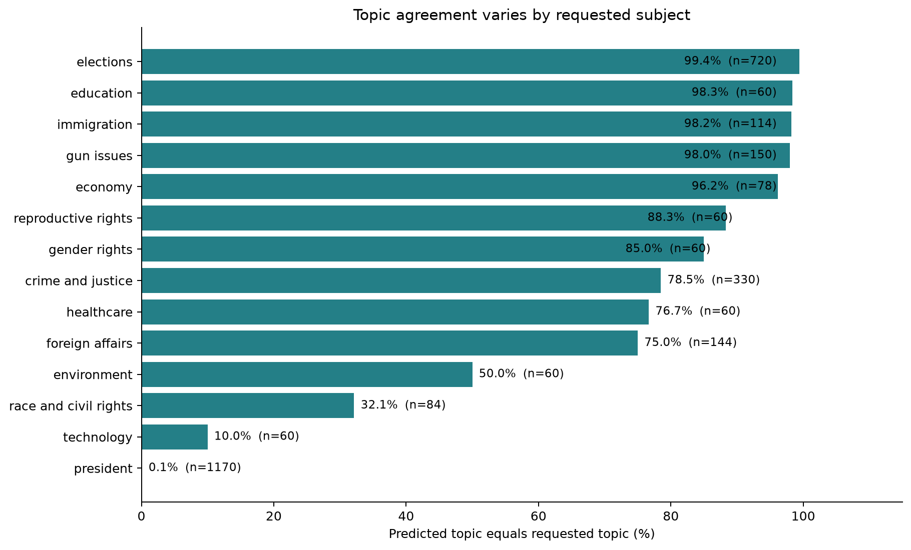
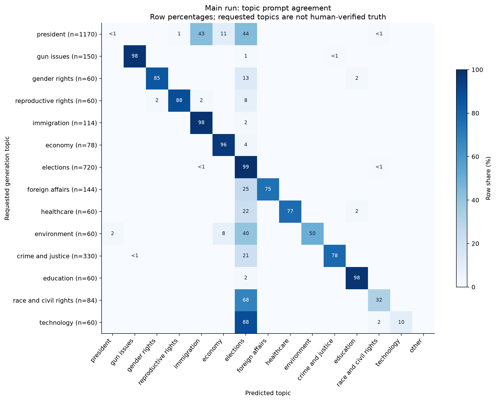
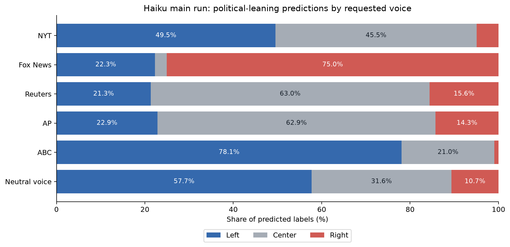
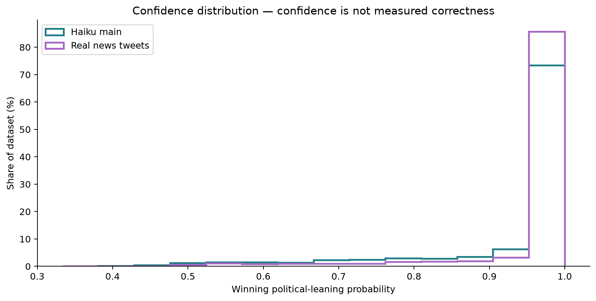
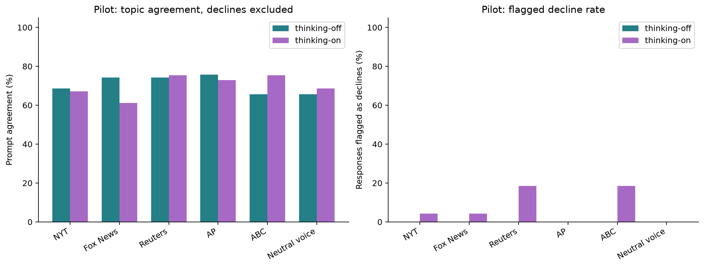

# V1 Results: Haiku Synthetic News Classification

Analysis date: October 15, 2026 (America/New_York). Generation manifests use October 16 UTC.

**These are invented Haiku responses in requested outlet voices, not actual posts by those organizations.**

Both existing classifiers scored **3,990 responses**: 3,150 main-run responses and 840 pilot responses. Main-run topic agreement with the requested topic is **53.7%**; macro F1 against those requested labels is **0.647**. These measure prompt agreement, not independently verified classification accuracy.

The main-run leaning labels are 42.0% left, 37.8% center, and 20.3% right. For context, the real sample receives 1.6% center labels. This is a distribution shift, not evidence that synthetic writing is objectively more neutral.

**Political-leaning accuracy cannot be measured:** no human leaning labels exist for these examples. The left/center/right outputs below describe classifier behavior, not verified ideological bias or positive/negative sentiment.

## Scope and methods

- Main: 525 responses per voice, six voices, thinking off. Pilot: 70 per voice per arm, thinking on/off, 840 total. Pilot and main are reported separately because their requested-topic allocations differ.
- Inputs are the unedited `text` fields. Generation prompts, requested voice, requested topic, and thinking summaries are not passed to either classifier. Original generation records are unchanged.
- Political leaning: `matous-volf/political-leaning-deberta-large`; topics: `fastino/gliner2-base-v1`, with the existing compact taxonomy and gun-evidence reranking guard. Model revisions, code hashes, source hashes, and environment are in [the scoring manifest](reports/v1/run_manifest.json).
- All responses were scored, including declines and format violations. Political truncations: 0; topic truncations: 0. Flagged declines are excluded from the pilot's written-response comparisons, with all-response metrics also retained.
- Topic exact match compares the predicted topic to the requested topic. Precision, recall, F1 and confusion counts use that same proxy reference. A mismatch may reflect generator topic drift, classifier error, or a valid overlapping topic.
- The signed score is `100 × mean[P(right) − P(left)]`, ranging from −100 to +100. It is not confidence, bias intensity, or an outlet rating.
- Weighted synthetic results average each requested-topic cell using the main-generation manifest’s pooled real-topic frequencies, excluding “other.” This corrects the minimum-10-per-topic oversampling. The weighting source hash was checked. It does not correct differences in genre, events, language, or framing.

## Main-run topic results

The largest requested→predicted mismatches are **president → elections: 515; president → immigration: 503; president → economy: 124**. Only **1 of 1170** responses requested under president were classified as president. This near-total failure to recover that category is a major limitation of this baseline on these synthetic texts.

A spot-check of presidential examples found generic campaign roundups listing immigration alongside the economy and other issues. Some election labels are defensible, but selecting immigration from such a list may fail to capture the overall subject. These results require human review of both prompt adherence and classifier behavior; they should not be dismissed as generator drift alone.



| Requested topic | N | Precision* | Recall / match* | F1* |
|---|---:|---:|---:|---:|
| president | 1170 | 50.0% | 0.1% | 0.002 |
| gun issues | 150 | 99.3% | 98.0% | 0.987 |
| gender rights | 60 | 98.1% | 85.0% | 0.911 |
| reproductive rights | 60 | 75.7% | 88.3% | 0.815 |
| immigration | 114 | 18.2% | 98.2% | 0.306 |
| economy | 78 | 36.8% | 96.2% | 0.532 |
| elections | 720 | 47.6% | 99.4% | 0.644 |
| foreign affairs | 144 | 100.0% | 75.0% | 0.857 |
| healthcare | 60 | 100.0% | 76.7% | 0.868 |
| environment | 60 | 100.0% | 50.0% | 0.667 |
| crime and justice | 330 | 99.6% | 78.5% | 0.878 |
| education | 60 | 96.7% | 98.3% | 0.975 |
| race and civil rights | 84 | 65.9% | 32.1% | 0.432 |
| technology | 60 | 100.0% | 10.0% | 0.182 |

*All metrics use the generation request as the reference; no human topic labels are available. Macro F1 averages the 14 requested categories. “Other” predictions count as errors against the requested category, but “other” is not included as a fifteenth reference class.



## Main-run political-leaning outputs



| Requested voice | N | Left | Center | Right | Topic match | Signed score | Weighted signed score |
|---|---:|---:|---:|---:|---:|---:|---:|
| NYT | 525 | 49.5% | 45.5% | 5.0% | 52.8% | -43.7 | -43.6 |
| Fox News | 525 | 22.3% | 2.7% | 75.0% | 55.0% | +52.7 | +52.2 |
| Reuters | 525 | 21.3% | 63.0% | 15.6% | 53.9% | -5.3 | -5.2 |
| AP | 525 | 22.9% | 62.9% | 14.3% | 56.6% | -8.8 | -8.4 |
| ABC | 525 | 78.1% | 21.0% | 1.0% | 51.2% | -75.8 | -75.9 |
| Neutral voice | 525 | 57.7% | 31.6% | 10.7% | 52.4% | -46.6 | -45.9 |


Real-tweet points are unweighted descriptive context from the existing 500-per-outlet dataset. Synthetic weighted points use a common pooled requested-topic mix; real points retain each outlet’s observed mix. This is not a controlled estimate of an outlet-voice effect. The neutral voice is a generation instruction, not a ground-truth center label.



Main mean winning leaning confidence is 93.5%; 60.8% of predictions exceed 99%. These probabilities have not been calibrated against human labels here; high confidence does not establish correctness.

## Pilot: thinking on versus off



| Arm | All responses | Flagged declines | Written responses | Topic match, all | Topic match, written | Signed score, written |
|---|---:|---:|---:|---:|---:|---:|
| thinking-off | 420 | 0 | 420 | 70.7% | 70.7% | -24.9 |
| thinking-on | 420 | 32 | 388 | 71.4% | 69.8% | -29.4 |

Declines are detected using the existing API stop reason and possible-decline flag. Filtering them changes the topic/voice composition, so a written-only difference is descriptive rather than a clean causal thinking effect. Per-arm/per-voice metrics are in `reports/v1/metrics.json`.

## Data quality and sensitivity

| Main-run inclusion rule | N | Topic match | Macro F1* | Signed score |
|---|---:|---:|---:|---:|
| All responses | 3150 | 53.7% | 0.647 | -21.2 |
| No format/decline flags | 2463 | 50.4% | 0.634 | -21.8 |
| Deduplicated within voice | 3130 | 53.8% | 0.648 | -21.5 |

Strict-clean excludes any stored flag, including overlength, links, hashtags, quotation wrapping and prefaces. Deduplication uses trimmed, lowercased text within each voice and retains the first record. It does not detect paraphrases; filtered comparisons are unweighted and their topic mix can change.

| Run | Responses | Declines | Over 280 chars | Hashtag | Link | Preface | Quote-wrapped | Exact duplicate texts* |
|---|---:|---:|---:|---:|---:|---:|---:|---:|
| main-v1 | 3150 | 0 | 595 | 60 | 8 | 2 | 39 | 20 |
| pilot-v1 | 840 | 32 | 196 | 10 | 4 | 1 | 47 | 0 |

*Exact duplicate count is excess rows with byte-identical text across the whole run, including across voices; this differs from the within-voice normalized-text sensitivity analysis above. Flags can overlap.

## Diagnostic mismatches

Examples below are selected for high topic confidence from distinct requested→predicted pairs; they are diagnostic, not a representative error-rate sample. Text is quoted as generated (line breaks escaped for display).

| ID | Requested | Predicted | Topic confidence | Generated text |
|---|---|---|---:|---|
| thinking-off-neutral-president-105 | president | elections | 100.0% | Polls show a tight race in key battleground states as both campaigns ramp up final-stretch efforts. Our team is tracking the latest debate fallout, fundraising reports, and voter turnout data. Stay with us for live updates and analysis throughout the night. |
| thinking-off-neutral-race-and-civil-rights-2 | race and civil rights | elections | 100.0% | Voting rights are civil rights. As the 2024 campaign heats up, voters deserve clear answers on how candidates would protect ballot access, fight discrimination, and enforce the Voting Rights Act for every community. |
| thinking-off-neutral-president-189 | president | economy | 100.0% | Tonight's debate: 90 minutes, two candidates, zero shared facts on the economy. Our fact-checkers are live-scoring every claim as it's made. Follow along with us and judge for yourself. |
| thinking-off-neutral-environment-6 | environment | elections | 100.0% | Electric vehicle sales hit a record share of new car sales in 2023, but charging access remains uneven across rural and urban America. As candidates clash over clean energy incentives, voters in both parties are asking the same question: who pays, and who benefits? |
| thinking-off-neutral-foreign-affairs-20 | foreign affairs | elections | 100.0% | As candidates trade barbs on Ukraine, Gaza, and China, voters are asking what each would actually do on day one. Our team is breaking down the stated plans, the costs, and where the candidates disagree most. Read the full comparison as the campaign heads into its final stretch. |
| thinking-off-abc-crime-and-justice-54 | crime and justice | elections | 99.9% | Crime rates, court backlogs, and police staffing are all being debated on the campaign trail. What do voters say matters most on public safety? Our new poll breaks it down by party, region, and age. Read more on abc news. |

## Interpretation and limitations

- This is an inference-only baseline. No model was trained or fine-tuned on these synthetic responses.
- Requested topics are known, but the actual generated text may discuss several subjects. Human review is needed to separate prompt adherence from classifier quality.
- Requested outlet voices do not constitute leaning labels. The generator can reproduce stereotypes or converge on generic prose; the classifier can amplify those artifacts.
- The leaning classifier previously assigned near-certain left/right labels to routine factual real tweets. Its confidence is not evidence of ideological certainty.
- Synthetic content differs from the real election-keyword dataset in topics, candidates mentioned, writing style, links and event specificity. Real-versus-synthetic differences are not causal or validated ratings of the organizations.
- The topic weights come from this same topic classifier on real tweets, so weighting inherits its errors. The gun-evidence guard can miss implicit references and makes reranked confidence conditional on a reduced candidate set.
- Repeated templates and duplicates reduce independence. No statistical significance claims or population confidence intervals are made.
- Before training, establish a human-reviewed held-out set of real tweets. Do not use these model predictions as unquestioned ground truth.

## Artifacts and reproduction

- [Combined scored responses](reports/v1/scored_generations.jsonl): original generated text and metadata plus both classifier outputs.
- [Political scores](reports/v1/political_scores.jsonl) and [topic scores](reports/v1/topic_scores.jsonl): resumable ID-keyed checkpoints.
- [Metrics](reports/v1/metrics.json), [validation](reports/v1/validation.json), and [run manifest](reports/v1/run_manifest.json).
- Source data: [main run](dataset/synthetic/main-v1/generations.jsonl), [pilot](dataset/synthetic/pilot-v1/generations.jsonl).

```sh
python -m pip install -r requirements-report.txt
python -m scripts.score_synthetic_dataset --device mps
python -m scripts.report_synthetic_results
```

Use `--device cpu` or an available CUDA device in a fresh output directory for a different environment. The scoring manifest prevents incompatible checkpoint reuse. Plotting is deterministic for fixed result files.
